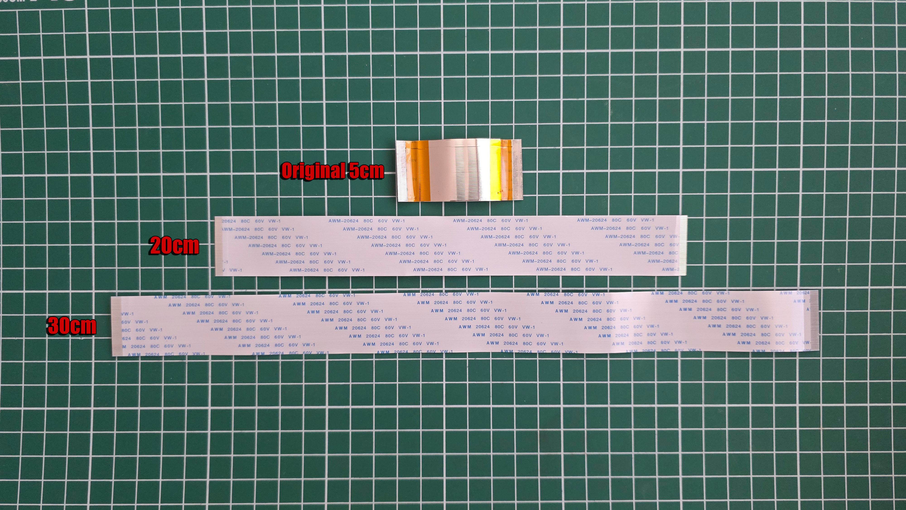

# FC1307A PSX DVR Firmware

Custom firmware for FC1307A SD-to-IDE adapters, adding support for the Sony PSX DVR vendor-specific HDD verification command `0x8E`.

The original FC1307A firmware does not support this command, causing the PSX to reject the adapter. This version adds the required 512-byte PIO response using the original FC1307A transfer routine.

The firmware extends SD card support beyond the original 128 GB limit and has been successfully tested with multiple SD card capacities on both first- and second-generation Sony PSX consoles.

It can also be used with compatible FC1307A-based 44-pin SD-to-IDE adapters commonly installed in PS2 Slim SCPH-700xx consoles.

## Supported Sony PSX revisions

The current setup supports both hardware revisions of the Sony PSX.

### PSX1 — First revision

Supported models:

- Sony PSX DESR-5000
- Sony PSX DESR-5100
- Sony PSX DESR-7000
- Sony PSX DESR-7100

Hardware-tested SD card capacities:

- 64 GB
- 128 GB
- 256 GB
- 512 GB
- 1 TB

32 GB media was tested experimentally, failed and is not supported.

PSX1 uses the standard PSX HDD layout and does not require the DVR partition layout, SETMAX/XFROM activation sequence or the PSX2 bootstrap.

### PSX2 — Second revision

Supported models:

- Sony PSX DESR-5500
- Sony PSX DESR-5700
- Sony PSX DESR-7500
- Sony PSX DESR-7700

Hardware-tested SD card capacities:

- 256 GB
- 512 GB
- 1 TB

SD cards of 128 GB or less are not supported on PSX2.

PSX2 uses a different HDD initialization process which includes the DVR layout, SETMAX handling, an MBR bootstrap and Sony XFROM activation.

The complete process is handled automatically by `RepairBox.pl PSX HDD Setup v1.0`.

## How the HDD check works

During startup, the PSX verifies the internal drive by writing `0xEC` to the ATA Features register and then issuing the vendor-specific command `0x8E`.

In the tested startup sequence, the console performs this verification twice.

```text
Features = 0xEC
Command  = 0x8E

Status   = 0xD0   BSY — drive is preparing the response
Status   = 0x58   DRQ — data is ready
Data     = 256 × 16-bit words = 512 bytes
Status   = 0x50   command completed without error
```

This is not a normal sector read. The command requests a Sony-specific 512-byte identification response.

The first 128 bytes contain identification and binary data, including:

```text
Sony Computer Entertainment Inc.DESR-7000        120
```

The remaining 384 bytes are filled with zeros. If the drive does not return the expected data transfer and status sequence, the PSX rejects it.

## Videos

### PSX1 — Original FC1307A HDD replacement project

[](https://youtu.be/S4Ubpu-f1K8)

[Watch the original PSX1 FC1307A modification video on YouTube](https://youtu.be/S4Ubpu-f1K8)

### PSX2 — Second revision support and automated HDD Setup

[](https://youtu.be/gVhUV-QnHn4)

[Watch the PSX2 support and RepairBox.pl PSX HDD Setup video on YouTube](https://youtu.be/gVhUV-QnHn4)

> [!NOTE]
> The first video documents the original PSX1-only procedure. The second video covers PSX2 support and the current `RepairBox.pl PSX HDD Setup v1.0`, which supports both PSX revisions and automatically performs the required storage preparation and system installation.

## Tested hardware

The supported Sony PSX models and hardware-tested SD card capacities are listed in the revision section above.

Tested FC1307A adapter types:

- FC1307A-based 40-pin SD-to-IDE adapter
- FC1307A-based 40-pin MicroSD-to-IDE adapter
- FC1307A-based 44-pin SD-to-IDE adapter for PS2 Slim SCPH-700xx

## Connecting the adapter to the PSX

> [!CAUTION]
> The 40-pin IDE connector in the PSX is mounted upside down compared with a standard IDE hard drive. It has no key, so the cable can easily be connected the wrong way around.
>
> Before powering on the console, compare the cable orientation with the original HDD and make sure pin 1 is in the correct position. Connecting it backwards may damage the adapter or the console.

## FFC cable extension tests

The original ribbon cable between the PSX mainboard and the IDE connector board is approximately 5 cm long. This leaves very little room for positioning an SD-to-IDE adapter inside the console.

The cable used in the tested first-generation PSX consoles has the following specification:

- 50-pin FFC
- 0.5 mm pitch
- Contacts on the same side at both ends
- Original length: approximately 5 cm

Initial tests were performed with replacement cables measuring 20 cm and 30 cm.

Both cable lengths successfully allowed the PSX to boot the system from the SD card using the FC1307A adapter.

The **20 cm cable is currently recommended**, as it provides significantly more room for positioning the adapter while keeping the cable as short as reasonably possible.

> [!NOTE]
> These were initial functionality tests only. Long-term stability, HDD recording, game loading and extended read/write operations have not yet been fully tested with the longer cables.
>
> The 30 cm cable successfully booted the PSX system, but the 20 cm version is preferred unless the additional length is required.

### Test photos

Photos from the 20 cm and 30 cm cable tests, including installation examples and cable comparison, are available in the repository:

[View PSX1 FFC extension cable test photos](docs/images/psx1/ffc-extension/)

### Cable comparison



## Preparing the SD card

The old manual HDD Manager formatting procedure is no longer required.

`RepairBox.pl PSX HDD Setup v1.0` automatically prepares the HDD/SD card layout and installs the required PSX system files.

### 1. Flash the FC1307A firmware

Flash the modified firmware to the FC1307A adapter.

Tested SPI flash IC:

```text
BY25D40EST
```

Adapter production batches may also use differently marked compatible 512 KB SPI flash chips such as:

```text
P25D40SH
```

> [!WARNING]
> Always make a backup of the original SPI flash before programming.
>
> Verify that the adapter uses an FC1307A controller and a compatible 512 KB SPI flash chip before flashing.

### 2. Prepare the USB drive

Download one of the complete installation packages from the [Downloads](#downloads) section below.

Each PL, EN or JP package already includes:

- `RepairBox.pl PSX HDD Setup v1.0`
- PSX1 system files — PSX OS v1.31
- PSX2 system files — PSX OS v2.11
- the tested `wLaunchELF_R3Z` build used to launch the Setup application

A separate download of the Setup ELF is **not required**.

For the most compatible and straightforward setup, a **USB flash drive up to 32 GB formatted as FAT32 is recommended**.

Extract the selected package to the USB drive and preserve the supplied folder structure. Do not run the installation directly from inside the ZIP archive.

For PSX2, the extracted files must also include the required `RepairBox-PSX2-Bootstrap` runtime folder used by the Setup application. PSX1 does not use this bootstrap.

> [!NOTE]
> The 32 GB FAT32 recommendation is for the documented installation workflow and maximum compatibility. It is not a statement that every larger USB device is necessarily incompatible.

### 3. Start RepairBox.pl PSX HDD Setup

An FMCB memory card is required to start the Setup application.

Use the **wLaunchELF_R3Z** build included in the installation package to launch:

```text
RepairBox.pl-PSX-HDD-Setup-v1.0.elf
```

The included wLaunchELF_R3Z build is the version used and tested with the current PSX workflow. See the [wLaunchELF_R3Z](#wlaunchelf_r3z) section below for details.

On the first screen select the correct PSX revision:

```text
[ L1 ] PSX1
[ R1 ] PSX2
```

Make sure the selected revision matches your console model.

### 4. Confirm the destructive operation

The setup will erase the existing HDD/SD card layout.

Follow the on-screen instructions and confirm the destructive operation with:

```text
L1 + R1 + X
```

### 5. Let the Setup complete the installation

For PSX1, the application automatically:

- creates the required APA partition layout
- formats all required PFS partitions
- installs the PSX1 system files
- verifies copied files and filesystem structures

For PSX2, the application additionally handles:

- SETMAX preparation
- required full cold-boot stages
- DirectReady40 storage preparation
- DVR partition layout
- PSX2 MBR bootstrap
- PSX2 system files
- XFROM `40/1` activation
- final readback and validation

If the application requests a full power cycle during the PSX2 procedure, completely disconnect AC power before continuing.

### 6. Final power cycle

After the installation completes:

1. Power off the PSX completely.
2. Disconnect AC power.
3. Reconnect AC power.
4. Start the PSX normally.

During system startup, both revisions show the animated loading sphere in the upper-right corner.

- **PSX1:** when loading finishes, the XMB appears automatically.
- **PSX2:** when the loading sphere disappears, press **SELECT** on the controller to display the XMB.

This PSX2 behavior is expected with the tested installation and does not indicate that the system failed to load.

## System file notes

A full sector-by-sector HDD image is not required.

The Setup application creates the required HDD structures and copies the required system files individually.

### PSX1

The same PSX1 system files can be used on supported first-generation PSX models.

When manually restoring system files copied from another console, another source or a different PSX model, delete:

```text
hdd0:__system/registry.db
```

The file may be kept when restoring a backup created on the same console to that same console.

Otherwise, it will be recreated automatically during the next startup.

This manual step is only relevant when restoring loose files manually. Use of the prepared RepairBox system package with the Setup application is recommended.

### PSX2

PSX2 uses its own v2.11 system package and a different HDD/DVR layout.

Do not use PSX1 v1.31 system files on a PSX2 console.

Do not manually substitute PSX1 partitions, MBR data or system files into a PSX2 installation.

Use the PSX2 package together with `RepairBox.pl PSX HDD Setup v1.0`.

## Technical storage layout

`RepairBox.pl PSX HDD Setup v1.0` creates the required Sony PSX storage layout automatically. The information below is provided for technical reference, documentation and troubleshooting only.

All addresses and sizes below are expressed in **512-byte sectors**.

> [!IMPORTANT]
> These values are informational only. Do not create, resize or move these partitions manually. Use `RepairBox.pl PSX HDD Setup v1.0` to prepare the storage device.

### PSX1 storage layout

PSX1 uses a fixed five-entry APA layout:

```text
Partition    Start        Size
__mbr        0x00000000   0x00040000
__net        0x00040000   0x00040000
__system     0x00080000   0x00080000
__sysconf    0x00100000   0x00100000
__common     0x00200000   0x00200000
```

This corresponds to:

- `__mbr` — 128 MiB
- `__net` — 128 MiB
- `__system` — 256 MiB
- `__sysconf` — 512 MiB
- `__common` — 1 GiB

The complete fixed PSX1 system APA area ends at sector `0x00400000`, which is 2 GiB from the beginning of the storage device.

The four PFS volumes (`__net`, `__system`, `__sysconf` and `__common`) use a zone size of `8192` bytes.

### PSX2 storage layout

PSX2 starts with the same five standard APA system partitions:

```text
Partition    Start        Size
__mbr        0x00000000   0x00040000
__net        0x00040000   0x00040000
__system     0x00080000   0x00080000
__sysconf    0x00100000   0x00100000
__common     0x00200000   0x00200000
```

PSX2 additionally uses a separate DVR layout beginning at the Sony 40 GB boundary:

```text
Partition     Start        Size / End
__extend      0x04A817C8   0x00040000
__xdata       0x04AC17C8   0x00200000
__xcontents   0x04CC17C8   dynamic
```

Sector `0x04A817C8` equals `78,125,000` sectors, or exactly `40,000,000,000` bytes.

`__xcontents` does not have one fixed size. Its end is calculated from the usable storage capacity detected by the Setup application. The verified layout reserves the final `0x800` sectors, so the end is calculated as:

```text
__xcontents end = GETMAX - 0x800
```

This allows the PSX2 DVR layout to scale to the supported media capacity instead of using a hard-coded `__xcontents` size.

The PSX2 Setup process also performs the required SETMAX preparation, DVR initialization, MBR bootstrap installation and XFROM `40/1` activation automatically.

### PSX2 MBR bootstrap

The PSX2 partition layout alone is not sufficient to boot the system. PSX2 also requires an additional MBR bootstrap that is not used by PSX1.

The bootstrap is supplied as an external runtime package:

```text
RepairBox-PSX2-Bootstrap/
├── mbr_bootstrap_prefix.bin
└── SHA256SUMS.txt
```

During a PSX2 installation, `RepairBox.pl PSX HDD Setup v1.0` automatically:

1. validates the bootstrap file using SHA-256;
2. writes the required bootstrap data to the logical MBR area;
3. reads the written data back and verifies it;
4. continues with the remaining PSX2 storage initialization and activation sequence.

> [!NOTE]
> The bootstrap binary is not embedded in the Setup ELF and is not required to build the application. It must be present on the USB drive when preparing a PSX2 storage device. PSX1 never uses this bootstrap package.

The bootstrap package is handled automatically by the Setup application. It should not be written to the storage device manually.

## RepairBox.pl PSX HDD Setup project

The HDD Setup application has its own GitHub repository with the installer source code, build information and detailed usage documentation:

- [RepairBox.pl PSX HDD Setup on GitHub](https://github.com/DanielFergisz/RepairBox-PSX-HDD-Setup)

The FC1307A firmware repository and the HDD Setup project are related but separate. The modified FC1307A firmware provides the PSX-specific ATA `0x8E` response, while the Setup application prepares the SD card/HDD layout and installs the required PSX system files.

The GitHub repository is intended for the Setup source code, build information and technical documentation. End users do not need to download the Setup ELF separately when using one of the complete PL/EN/JP installation packages below.

## Downloads

The language packages are complete installation bundles. Each package includes `RepairBox.pl PSX HDD Setup v1.0`, the required PSX1 v1.31 and PSX2 v2.11 system files, and the tested wLaunchELF_R3Z launcher.

Choose the package matching the system language you want to install:

- [Polish package — PL](https://drive.google.com/file/d/14h86nt2Myi-6ReXkYhU1_xzZA640sIjz/view?usp=sharing)
- [English package — EN](https://drive.google.com/file/d/1Tn6brdV7pmyhIxk6ZWJ1auCVyxPAPnPV/view?usp=sharing)
- [Original Japanese package — JP](https://drive.google.com/file/d/10JWiaM9BJDOFjaYJY0EzrbPxC-XJ3pUB/view?usp=sharing)

> [!NOTE]
> Each language package contains the system files for both PSX1 and PSX2. Select the correct console revision in `RepairBox.pl PSX HDD Setup v1.0`; do not mix PSX1 v1.31 files with a PSX2 installation or PSX2 v2.11 files with a PSX1 installation.

## wLaunchELF_R3Z

The current installation procedure uses **wLaunchELF_R3Z** rather than the older uLaunchELF builds used by the original manual method.

wLaunchELF_R3Z is a modern wLaunchELF fork with PSX-specific device support including `xfrom:/` and `dvr_hdd0:/`. It is the launcher used and tested with the current RepairBox PSX1/PSX2 setup workflow.

A tested wLaunchELF_R3Z ELF is already **included in every RepairBox installation package**, so a separate download is not required for normal installation.

Upstream project and source code:

- [wLaunchELF_R3Z by saildot4k](https://github.com/saildot4k/wLaunchELF_R3Z)

> [!NOTE]
> Use the wLaunchELF_R3Z version supplied with the RepairBox package for the documented installation procedure. Older uLaunchELF builds are no longer part of the recommended workflow.

## Important notes

> [!WARNING]
> Always make a backup of the original FC1307A SPI flash before programming.
>
> Verify that the adapter uses an FC1307A controller and a compatible 512 KB SPI flash chip before flashing.

> [!CAUTION]
> HDD/SD card preparation is destructive. Existing partitions and data on the selected storage device will be erased.

> [!NOTE]
> PSX1 and PSX2 use different storage layouts and initialization procedures. Always select the correct revision for your console.
